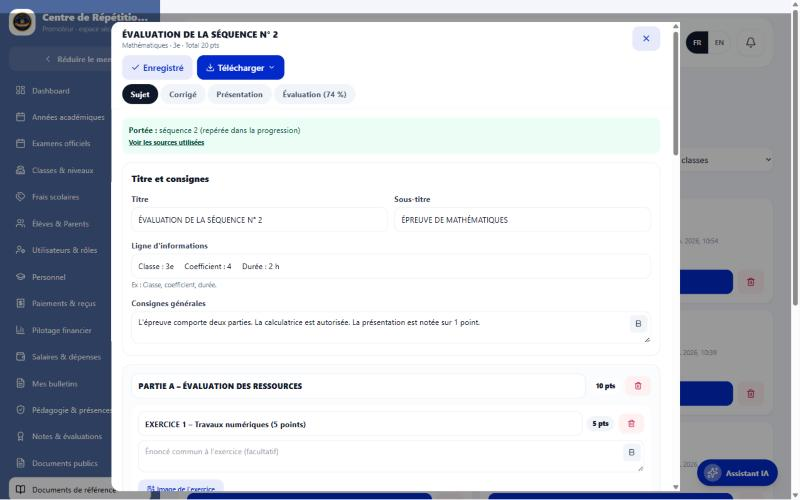
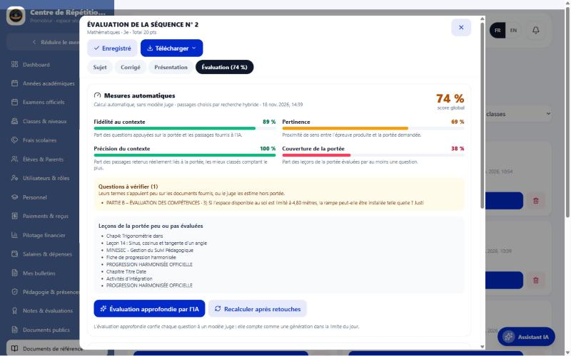

# SCOLIA

Plateforme de gestion d'établissement secondaire qui génère des épreuves d'évaluation conformes aux programmes officiels camerounais, par génération augmentée par récupération (RAG). Déployée pour le Groupe LE SUCCÈS (Douala). Projet présenté pour le Master de Technologie en TIC de l'ENSET de Douala, soutenu le 14 novembre 2026 (mention Excellent, félicitations du jury).

Ce dépôt présente le projet. Le code source est privé, car la plateforme est en production chez un client.

## Fonctions

- Gestion de l'établissement : élèves, classes, enseignants, affectations, emplois du temps, finances mensuelles et reçus.
- Documents de référence par classe : programmes officiels et progressions harmonisées, de la 6e à la Terminale, sections francophone et anglophone, enseignement général et technique.
- Génération d'épreuves : l'enseignant indique la classe, la matière et la séquence ; le système retrouve les passages pertinents par recherche hybride et le modèle de langage rédige le sujet, le corrigé et la présentation à partir de ce contexte. L'épreuve reste modifiable partie par partie, exercice par exercice.
- Évaluation automatique de chaque épreuve, sans modèle juge : fidélité au contexte (part des questions appuyées sur la portée et les passages fournis), pertinence par rapport à la portée demandée, précision du contexte récupéré et couverture des leçons de la portée. Les questions qui s'écartent des documents et les leçons non évaluées sont signalées à l'enseignant.
- Évaluation approfondie facultative par un modèle juge, question par question, avec suivi des limites de consommation.

## Architecture

- Backend Django et Django REST Framework, base PostgreSQL.
- Frontend React.
- Chaîne RAG : indexation des programmes officiels, récupération du contexte, génération par modèle de langage, contrôle avant publication.
- Déploiement sur serveur Linux avec SSL et sauvegarde quotidienne chiffrée.

## Ce que le projet a montré

Le modèle de langage produit des épreuves plausibles, mais rien ne garantit qu'elles respectent le programme, la progression des notions ou le barème. Les mesures automatiques actuelles le confirment : sur l'épreuve de la capture, la fidélité au contexte atteint 89 % mais la couverture de la portée n'est que de 38 %, et ces mesures restent statistiques. Elles ne disent pas si l'épreuve respecte formellement le référentiel. Cette limite est le point de départ de mon Master recherche : modéliser formellement le référentiel curriculaire pour évaluer automatiquement la conformité des épreuves générées, en séparant la génération de la vérification.

## Captures d'écran

Site public du centre :

Épreuves générées, avec leur score de qualité :

Éditeur d'épreuve et portée retenue dans la progression :

Mesures automatiques de qualité d'une épreuve :

Les écrans de gestion (finances, élèves, personnel) ne sont pas montrés, car ils contiennent des données personnelles.

Auteur : Steve MBOSOP TETSING, mbosopsteve@gmail.com
